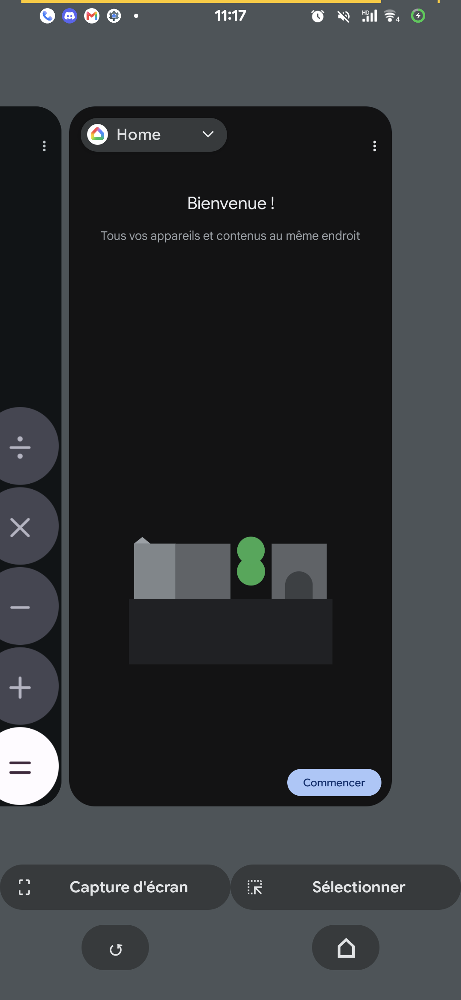
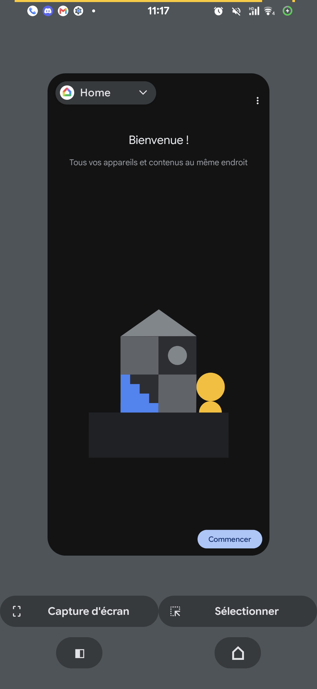
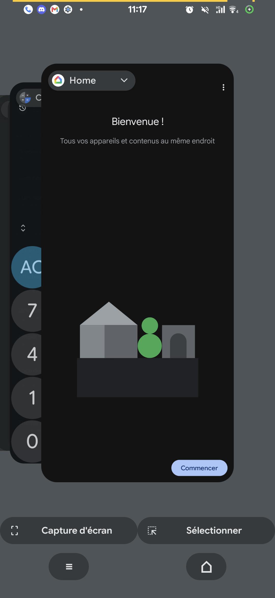
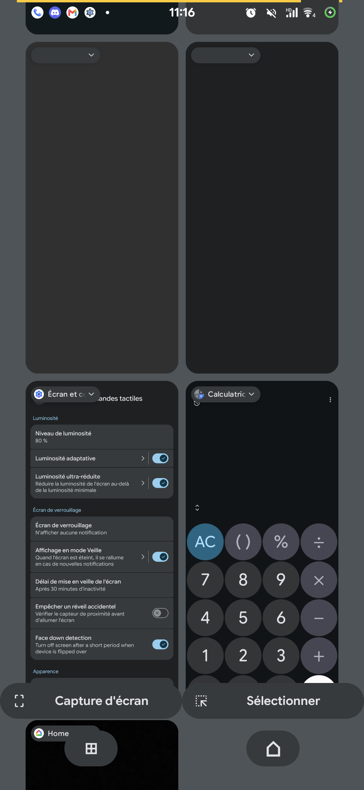

# Launcher3 Recents Mod

An Xposed/Vector module that adds alternative Recents layouts to Launcher3 and Pixel Launcher. It was developed for Evolution X and tested with Pixel Launcher `NexusLauncherRelease.apk` v17 on Android 17 (SDK 37).

## Screenshots

Captured on-device. The launcher UI is localized in French; screenshots show the actual layouts and controls.

<table>
  <tr>
    <td align="center"><strong>Stock</strong><br></td>
    <td align="center"><strong>Flip</strong><br></td>
  </tr>
  <tr>
    <td align="center"><strong>Stack</strong><br></td>
    <td align="center"><strong>Grid</strong><br></td>
  </tr>
</table>

## Layouts and controls

The view selector sits below the Screenshot action and cycles through **Stock → Flip → Stack → Grid**. The Home button below Select returns to the launcher home screen. Stock is the default layout.

- **Stock** keeps the launcher's original carousel.
- **Flip** arranges task cards as a 3D cover flow, with perspective, rotation, fading, and scaling toward the sides.
- **Stack** draws cards with a centered, overlapping depth effect.
- **Grid** places tasks in two columns. Scroll vertically with inertia, swipe a card horizontally to dismiss it, or tap it to open. Gesture direction locks after the initial movement so vertical scrolling and dismissal do not compete.

### Grid resets after a Home round-trip

Launcher3's `RecentsViewStateController` animates the `recentsGrid` property to 0 on every state transition (it is only 1 when the overview is displayed as a grid), and `RecentsView.onLayout` recomputes each card's grid translation. Both run after the module placed the grid, so every card fell back to the carousel offset and stacked at the centre: a single card remained visible.

The module now re-asserts `setGridProgress(1)` and the grid translations on every grid pass, re-places the grid at the end of each `RecentsView` layout pass and on re-attach, and verifies the channels at draw time so a stale grid is corrected within ~100 ms instead of up to 500 ms.

### Black task cards

The running task could appear black in custom layouts because the module disabled the launcher's Live Tile while the running task still had no snapshot to render. The module now asks Launcher3 to show a screenshot of the running task when switching to a custom layout, and restores normal behavior in Stock mode.

Android may still show a plain background for tasks whose snapshots are unavailable or whose content is protected. The module cannot display a preview that Android does not provide. This follows Launcher3's thumbnail states: a live tile, a snapshot, or a background-only thumbnail ([AOSP thumbnail view model](https://android.googlesource.com/platform/packages/apps/Launcher3/%2B/2ba372343bc0afa81e30d6d3e80925c4e9971e6b/quickstep/src/com/android/quickstep/task/viewmodel/TaskThumbnailViewModelImpl.kt), [AOSP thumbnail view](https://android.googlesource.com/platform/packages/apps/Launcher3/%2B/6df1743d23595bc9b800c9e81fcaae085ad47951/quickstep/src/com/android/quickstep/task/thumbnail/TaskThumbnailView.kt)).

## Requirements

- Android 17 / SDK 37 for the tested build.
- An Xposed-compatible framework, such as Vector, with the module enabled for the system launcher.
- Root access to install and activate the framework module.

The module targets `com.google.android.apps.nexuslauncher` and `com.android.launcher3`. The Pixel Launcher package is the tested target; other Launcher3 builds may differ in private methods and layout behavior.

## Install

1. Install the APK at `build/launcher3mod-pixel.apk`.
2. Enable **Launcher3Mod Stacking** in Vector and include Pixel Launcher (`com.google.android.apps.nexuslauncher`) in its scope. Enable system apps in the scope picker if needed.
3. Force-stop the launcher or reboot, then open Recents.
4. Use the view selector under Screenshot to change layouts.

## Build

On Windows, run the provided manual build script:

```powershell
.\build.ps1
```

The script invokes `javac`, `d8`, `aapt2`, `zipalign`, and `apksigner`. It requires JDK 25, Android SDK Platform 37, Android Build Tools 36.0.0, and the Xposed API 82 jar in the paths configured by the script. The output is `build/launcher3mod-pixel.apk`.

## Implementation

Launcher3 performs its normal layout first. The module hooks `RecentsView.updateCurveProperties()` and applies per-frame transforms to task cards for the selected layout. Grid mode handles vertical scrolling, horizontal dismissal, card removal, and reflow so remaining cards close gaps.

Main files:

- `app/src/main/java/com/launcher3mod/stacking/RecentsStack.java` — Vector/Xposed entry point.
- `app/src/main/java/com/launcher3mod/stacking/Stacker.java` — hooks, layouts, gestures, and controls.
- `app/src/main/assets/xposed_init` — module entry-point metadata.
- `build.ps1` — manual APK build.
